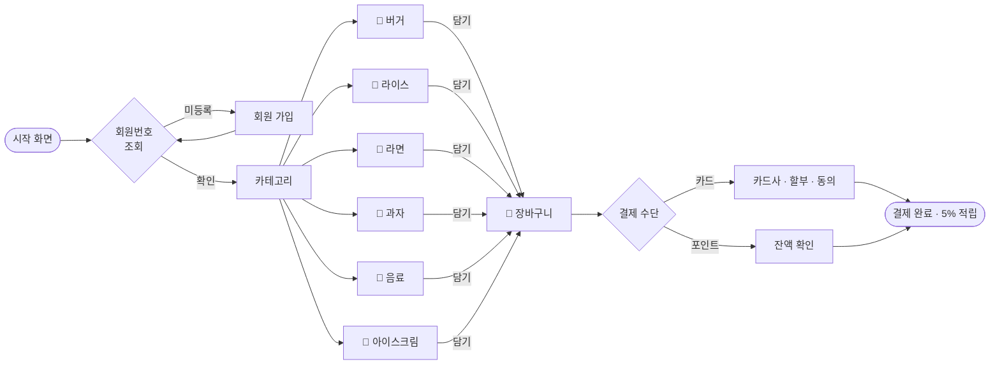

<div align="center">


**회원 인증부터 결제·포인트 적립까지, 매장 키오스크의 주문 흐름을 그대로 옮긴 데스크톱 앱**


</div>

<br>

## 📌 한눈에 보기

| | |
|---|---|
| **무엇을** | 버거 · 라이스 · 라면 · 과자 · 음료 · 아이스크림 6개 카테고리, **48개 메뉴**를 주문하는 키오스크 |
| **흐름** | 시작 → 회원번호 입력(미등록 시 가입) → 카테고리 → 메뉴 담기 → 장바구니 → 카드/포인트 결제 → 5% 적립 |
| **구조** | 화면(Form)과 데이터(Store)를 분리 — 모든 화면이 하나의 `Cartstore` · `Memberstore`를 공유 |
| **포인트** | 모델/저장소 분리 · `PictureBox.Tag` 데이터 바인딩 · `DialogResult` 기반 화면 간 결과 전달 |

<br>

## 🧭 주문 흐름



<br>

## ✨ 주요 기능

| 영역 | 기능 |
|---|---|
| 👤 회원 | 회원번호 조회 · 미등록 시 가입 화면 연결 · 중복 회원번호 차단 · 등급/포인트 표시 |
| 🍽 메뉴 | 6개 카테고리 × 8개 메뉴, 이미지 클릭으로 장바구니 담기 |
| 🛒 장바구니 | 담은 항목 목록 · 선택 삭제 · 합계 자동 계산 · 빈 장바구니 결제 차단 |
| 💳 결제 | 카드사 · 할부 개월 선택, 개인정보 동의 검증 / **포인트 결제**(잔액 부족 시 차단) |
| 🎁 적립 | 결제 금액의 **5% 포인트 적립**, 결제 후 장바구니 자동 비움 |

<br>

## 🔧 설계 포인트

<details open>
<summary><b>1. 화면과 데이터 분리 — Store 클래스</b></summary>
<br>

메뉴 화면이 6개로 나뉘어 있어도 장바구니는 하나여야 합니다.
각 폼이 리스트를 따로 들고 있지 않고 **정적 저장소 클래스**를 공유하도록 만들었습니다.

```
Product / Member          ← 모델 (데이터 형태)
Productstore              ← 상품 목록 · 카테고리별 조회 (LINQ)
Cartstore                 ← 담기 · 삭제 · 합계 · 비우기
Memberstore               ← 조회 · 가입(중복 검사) · 포인트 증감
*Form.cs                  ← 화면은 Store만 호출
```

```csharp
public static List<Product> GetByCategory(string category)
    => products.Where(p => p.Category == category).ToList();

public static int GetTotal() => cart.Sum(p => p.Price);
```
</details>

<details>
<summary><b>2. 이미지에 상품 객체를 바인딩 — <code>Tag</code></b></summary>
<br>

메뉴 이미지마다 클릭 이벤트를 따로 만들지 않고, `PictureBox.Tag`에 `Product`를 넣어 **하나의 핸들러로 처리**합니다.

```csharp
private void Product_Click(object sender, EventArgs e)
{
    if ((sender as PictureBox)?.Tag is Product product)
    {
        Cartstore.Add(product);   // 모든 폼이 공유하는 장바구니에 추가
        MessageBox.Show($"{product.Name} 담았습니다. (현재 {Cartstore.GetItems().Count}개)");
    }
}
```
</details>

<details>
<summary><b>3. 모달 결과로 화면 흐름 제어 — <code>DialogResult</code></b></summary>
<br>

카드 결제 창 → 결제 창 → 장바구니 창이 **결과(OK/Cancel)를 위로 전달**하며 닫히도록 해,
결제를 취소하면 이전 화면에 그대로 남고, 성공하면 카테고리 화면으로 돌아갑니다.

```csharp
var result = new CardPaymentForm(totalAmount).ShowDialog();
if (result == DialogResult.OK) ProcessPayment("카드");
```

```csharp
private void ProcessPayment(string method)
{
    if (method == "포인트")
        Memberstore.UpdatePoints(currentMember.MemberId, -totalAmount);   // 차감

    int earned = (int)(totalAmount * 0.05);                               // 5% 적립
    Memberstore.UpdatePoints(currentMember.MemberId, earned);
    Cartstore.Clear();
}
```
</details>

<details>
<summary><b>4. 입력 검증</b></summary>
<br>

- 회원번호 미입력 · 이름 누락 → 가입 차단 / 이미 있는 회원번호 → 가입 거부
- 장바구니가 비어 있으면 결제 화면으로 넘어가지 않음
- 카드사 · 할부 미선택, 개인정보 미동의 → 승인 차단
- 포인트 잔액 < 결제 금액 → 포인트 결제 차단
</details>

<br>

## 📁 프로젝트 구조

```
Kiosk/
├── First.cs                  # 시작 화면
├── MainFrom.cs               # 회원번호 입력 · 조회
├── Register.cs               # 회원 가입
├── Categoryform.cs           # 카테고리 선택
├── BurgerForm.cs 외 5개       # 카테고리별 메뉴 화면
├── Cartform.cs               # 장바구니
├── PaymentForm.cs            # 결제 수단 선택 · 적립
├── CardPaymentForm.cs        # 카드 결제
├── Product.cs · Productstore.cs
├── Member.cs  · Memberstore.cs
└── Cartstore.cs
```

<br>

## ▶️ 실행 방법

Visual Studio 2022에서 `Kiosk.sln` 열고 `F5`

<br>

## 🚀 다음 단계

- 회원 · 주문 데이터를 메모리 대신 **MySQL에 저장**해 프로그램 종료 후에도 유지
- 같은 메뉴를 여러 번 담으면 **수량으로 합산**하는 장바구니
- 주문 내역 조회 · 매출 집계 관리자 화면


