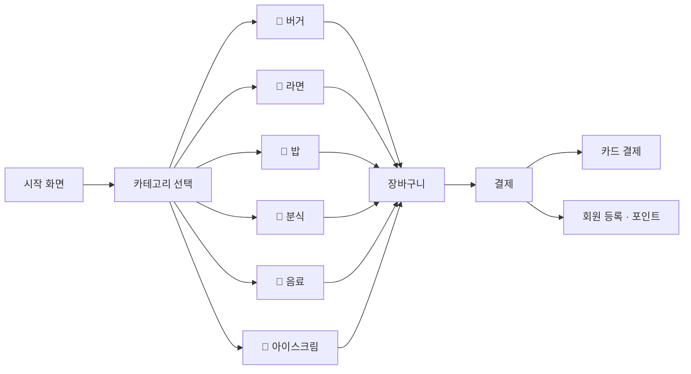

# 🍔 Kiosk

**분식 · 패스트푸드 매장 주문 키오스크**

## 📌 소개
메뉴 선택부터 장바구니, 결제, 회원 포인트까지 실제 매장 키오스크의 주문 흐름을 C# WinForms로 구현했습니다.

## 🧭 화면 흐름

## ✨ 주요 기능
- 6개 카테고리 메뉴 화면
- 장바구니 담기 · 수량 변경 · 합계 자동 계산
- 결제 / 카드 결제 화면
- 회원 등록(회원번호 · 이름 · 전화번호, 개인정보 동의) 및 포인트 조회

## 🗂 구조
| 파일 | 역할 |
|---|---|
| `Product.cs` · `Productstore.cs` | 상품 모델 · 상품 목록 |
| `Cartstore.cs` · `Cartform.cs` | 장바구니 데이터 · 화면 |
| `Member.cs` · `Memberstore.cs` · `Register.cs` | 회원 · 포인트 |
| `PaymentForm.cs` · `CardPaymentForm.cs` | 결제 |
| `BurgerForm.cs` 외 5개 | 카테고리별 메뉴 화면 |

## ▶️ 실행 방법
Visual Studio 2022에서 `Kiosk.sln` 열고 `F5`
